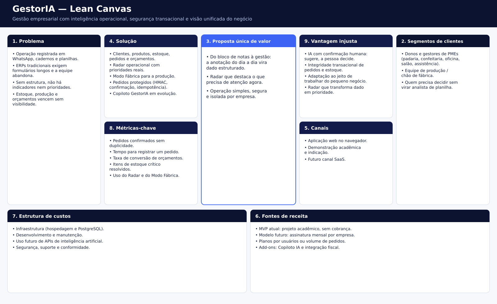
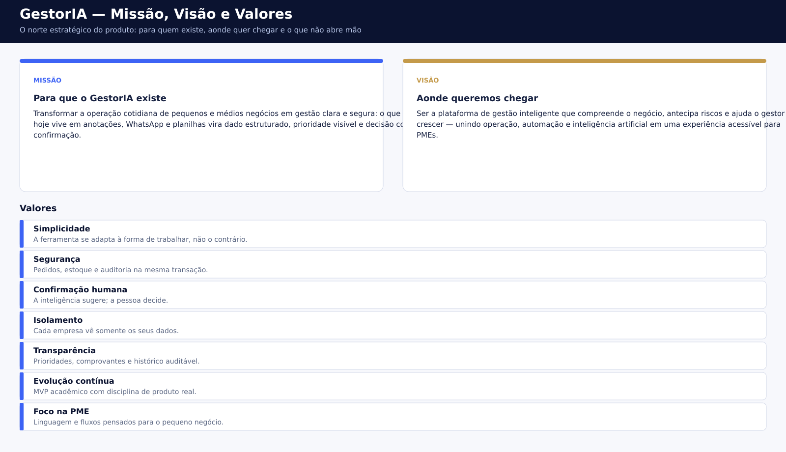

# Documento de Contexto

**Produto:** GestorIA

**Tipo:** plataforma de gestão empresarial web e mobile

**Situação:** MVP acadêmico funcional em evolução

**Disciplinas de origem:** TAI III e gestão de startups — 6º período

**Atualização desta revisão:** outubro de 2026

**Documentos relacionados:** [Especificação do Projeto](<Especificação do Projeto.md>), [README](README.md) e [índice da documentação](docs/README.md)

---

## 1. Identificação

O **GestorIA** é uma plataforma de gestão para pequenos e médios negócios. A aplicação web concentra cadastros e operação detalhada; o aplicativo mobile oferece acompanhamento executivo, alertas, Copiloto e acesso contextual aos módulos.

O produto centraliza clientes, produtos, estoque, pedidos, orçamentos, produção, documentos fiscais, finanças e gestão interna. Esses dados também alimentam uma visão executiva que responde rapidamente: **“Minha empresa está bem e o que precisa da minha atenção agora?”**

O projeto nasceu como trabalho acadêmico, mas utiliza uma estrutura compatível com aplicação real: backend em camadas, PostgreSQL, isolamento entre empresas, operações transacionais, sessões revogáveis, permissões e testes automatizados.

## 2. Problema

Pequenas empresas frequentemente registram o dia a dia em mensagens, cadernos e planilhas. Essas ferramentas são rápidas, mas espalham as informações: fica difícil saber o que está em produção, o que falta no estoque, quais documentos ou orçamentos exigem atenção e como está a situação financeira.

Sistemas tradicionais trazem estrutura, porém podem exigir atenção excessiva, muitos campos e navegação complexa. Quando a experiência não acompanha o ritmo do negócio, a equipe volta ao registro informal e o sistema deixa de representar a operação real.

O GestorIA procura equilibrar os dois lados: agilidade para registrar e clareza para controlar.

## 3. Oportunidade

Há espaço para uma experiência que organize a operação sem afastar o usuário. O GestorIA se apoia em quatro hipóteses:

1. o gestor quer visualizar prioridades antes de navegar por relatórios;
2. a equipe adere ao sistema quando os fluxos são rápidos e compreensíveis;
3. pedidos, estoque e finanças precisam de regras transacionais e auditáveis;
4. linguagem natural pode reduzir a distância entre a dúvida do gestor e o módulo correto, desde que não invente informações nem execute ações críticas sem confirmação.

O painel executivo, os alertas e o Copiloto controlado já materializam parte dessa proposta. A integração futura com um provedor de IA deverá preservar as mesmas regras de autorização, isolamento, confirmação e auditoria.

## 4. Público-alvo

| Perfil | Necessidade principal |
|---|---|
| Proprietário ou gestor de PME | visão única da empresa e prioridades sem depender de várias planilhas |
| Equipe administrativa | cadastros, pessoas, finanças e documentos com regras claras |
| Equipe comercial | clientes, pedidos e orçamentos conectados |
| Equipe de produção | fila de pedidos, receitas, disponibilidade e consumo de insumos |
| Segmentos iniciais | padarias, confeitarias, oficinas, salões, assistências e negócios semelhantes |

O cadastro da empresa e o contexto do segmento preparam o produto para adaptar linguagem, indicadores e fluxos sem misturar dados entre organizações.

## 5. Contexto acadêmico e de produto

O GestorIA é desenvolvido como projeto de curso com ambição de produto. Isso exige duas disciplinas simultâneas:

- **acadêmica:** documentar problema, arquitetura, estratégia, contribuição individual e evolução do MVP;
- **de produto:** preservar segurança, experiência, dados reais, testes e um caminho crível até um serviço comercial.

O estado atual é de **MVP funcional em evolução**. Web, API e banco cobrem os principais domínios. O aplicativo mobile já possui a jornada executiva central, enquanto os demais módulos são integrados progressivamente. Emissão fiscal externa, pagamentos e IA generativa em produção ainda não fazem parte da entrega.

## 6. Solução em uma frase

O GestorIA transforma a operação da pequena empresa em informação estruturada, prioridades e decisões seguras, no computador ou no celular.

A visão de longo prazo mantém a linguagem natural como porta de entrada:

```text
Pergunta ou intenção → interpretação → consulta ou proposta → confirmação → operação auditável
```

Exemplo da visão: *“Maria pediu dois bolos de chocolate de 2 kg para sábado por 160 reais.”* Antes de qualquer escrita, o sistema deverá identificar os dados, apresentar o resumo e solicitar confirmação.

No MVP atual, o Copiloto reconhece perguntas mapeadas e executa ferramentas controladas de consulta. Ele ainda não usa um provedor externo de IA nem executa ações críticas.

## 7. O que já existe no produto

### Plataforma

- aplicação web React e aplicativo Expo/React Native;
- API FastAPI compartilhada;
- PostgreSQL, SQLAlchemy e migrations Alembic;
- Docker Compose para desenvolvimento, testes e produção;
- Caddy e HTTPS na configuração de produção.

### Segurança

- sessões persistidas e revogáveis em cookies `HttpOnly`;
- senha protegida por Argon2;
- papéis `owner`, `admin` e `member`;
- isolamento por `organization_id`;
- proteção CSRF, limitação de login e controle de origens;
- operações de pedido com HMAC, idempotência, comprovante e auditoria.

### Domínios web e backend

- clientes e perfil comercial;
- produtos e estoque;
- pedidos e orçamentos;
- receitas, disponibilidade e fila de produção;
- documentos fiscais, fornecedores, vínculos e eventos;
- categorias, lançamentos, entradas, saídas e saldo financeiro;
- funcionários, vínculos, centros de custo e ocorrências;
- dados da empresa;
- dashboard, indicadores e prioridades;
- Copiloto controlado com respostas baseadas em ferramentas permitidas.

### Aplicativo mobile

- login e sessão integrados à API;
- início executivo;
- central de alertas;
- Copiloto controlado;
- acompanhamento de pedidos;
- catálogo de módulos;
- conta e contexto da empresa;
- identidade visual Sereno.

Os demais módulos aparecem como **Em integração** até receberem uma jornada móvel funcional.

## 8. Stakeholders

| Stakeholder | Interesse |
|---|---|
| Equipe de desenvolvimento | evoluir o MVP sem quebrar estoque, permissões, dados e segurança |
| Professores e banca | clareza de problema, proposta, documentação e contribuição |
| Empresa usuária | registrar a operação com confiança e enxergar prioridades |
| Gestor remoto | acompanhar indicadores, alertas e pedidos pelo celular |
| Equipes comercial, produtiva, fiscal e administrativa | operar seus módulos com contexto e permissão |
| Copiloto | consultar apenas ferramentas autorizadas e nunca inventar dados |

## 9. Escopo atual e limites

Fazem parte do MVP atual:

- operação web dos módulos listados;
- jornada executiva mobile;
- persistência real na API e no banco;
- documentos fiscais internos e seu ciclo de vida;
- consultas controladas do Copiloto;
- autenticação, permissões, isolamento e testes.

Continuam fora do escopo atual:

- emissão, autorização e cancelamento reais de NF-e/NFC-e em serviços governamentais;
- gateway de pagamento, assinatura comercial e cobrança;
- integração com WhatsApp ou e-mail transacional;
- troca de múltiplas empresas na mesma sessão;
- provedor externo de IA em produção;
- execução de ações críticas pelo Copiloto;
- integração mobile completa de todos os módulos;
- publicação comercial nas lojas de aplicativos.

## 10. Premissas e restrições

- uma sessão autenticada pertence a uma empresa;
- o cliente não escolhe livremente o `organization_id`;
- preço de pedido e orçamento é congelado no registro;
- estoque insuficiente bloqueia a operação sem gravação parcial;
- criação de pedido passa por proposta e confirmação;
- conversão de orçamento ainda não utiliza o envelope HMAC de pedidos;
- respostas do Copiloto devem indicar fonte e limite;
- nenhuma ação crítica pode ser executada sem permissão e confirmação;
- valores financeiros utilizam precisão decimal;
- centros de custo e lançamentos financeiros existem, mas ainda não possuem vínculo direto;
- o ambiente de referência utiliza React, Expo, FastAPI, PostgreSQL 17 e Docker Compose.

## 11. Referências internas

- [README](README.md) — visão geral e execução;
- [Especificação do Projeto](<Especificação do Projeto.md>) — requisitos e arquitetura;
- [Projeto de Interface](<docs/entregaEtapa3/Projeto de Interface.md>) — experiências web e mobile;
- [Arquitetura do Sistema](<docs/entregaEtapa3/Arquitetura do Sistema.md>) — camadas e decisões;
- [Copiloto MVP](docs/COPILOTO-MVP.md) — contrato controlado;
- [Segurança de pedidos](docs/SEGURANCA_PEDIDOS.md) — confirmação, HMAC e idempotência;
- [README de produto original](<Documentação de Contexto/README-produto.md>) — registro histórico da ideia inicial.

---

## Lean Canvas

O Lean Canvas resume o GestorIA em uma página: problema, cliente, proposta de valor, solução, canais, receita, custos, métricas e vantagem. Ele combina o estado atual do produto com sua direção de startup, sem tratar o MVP acadêmico como se já cobrasse assinatura.

Leitura útil:

- problema e segmentos justificam uma solução simples para a PME e rigorosa nas operações;
- a proposta de valor une acompanhamento executivo, operação estruturada e Copiloto;
- a vantagem não é apenas “ter IA”, mas combinar assistência com confirmação humana e integridade transacional;
- receita representa o modelo futuro; atualmente não existe cobrança.

A versão em PDF está em [docs/pdf/lean-canvas.pdf](docs/pdf/lean-canvas.pdf).



---

## Missão, Visão e Valores

Missão, visão e valores dizem por que o produto existe, aonde pretende chegar e o que não deve ser negociado durante a evolução.

- **Missão:** retirar a operação do informal e devolvê-la como gestão clara e segura.
- **Visão:** tornar-se uma plataforma que compreende o negócio e ajuda o gestor a antecipar riscos e decisões.
- **Valores:** clareza, segurança, confirmação humana, respeito aos dados e evolução responsável.

A versão em PDF está em [docs/pdf/missao-visao-valores.pdf](docs/pdf/missao-visao-valores.pdf).


