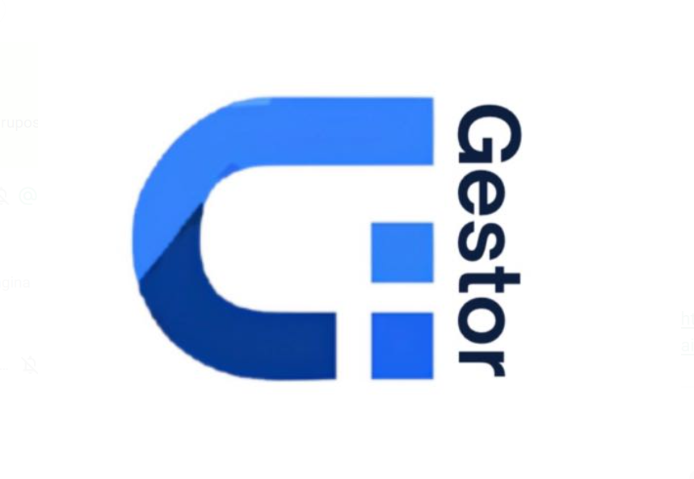
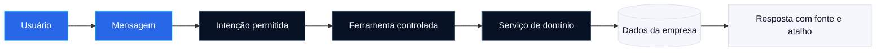
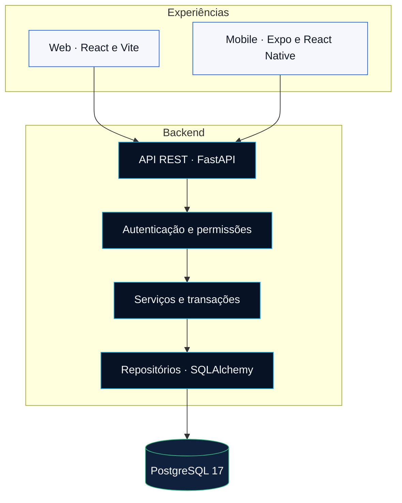

<div align="center">



# GestorIA

### Sua empresa, sob controle — onde você estiver.

Uma plataforma de gestão empresarial que conecta operação, indicadores e decisões em experiências web e mobile.

<br />


<br /><br />

[Visão do produto](#visão-do-produto) ·
[Módulos](#módulos) ·
[Arquitetura](#arquitetura) ·
[Executar](#executar-localmente) ·
[Documentação](#documentação) ·
[Equipe](#equipe)

</div>

---

## Visão do produto

O **GestorIA** reúne as áreas essenciais de uma empresa em uma única plataforma. A aplicação web oferece profundidade operacional; o aplicativo mobile entrega acompanhamento executivo, alertas e decisões rápidas.

> **A pergunta central do produto é simples:** “Minha empresa está bem e o que precisa da minha atenção agora?”

| Experiência web | Experiência mobile |
| :--- | :--- |
| Cadastros, operação detalhada e administração | Indicadores, prioridades e gestão à distância |
| Fluxos completos por módulo | Ações rápidas e navegação contextual |
| Uso em equipes e rotinas administrativas | Uso executivo em qualquer lugar |

### Princípios

- **Clareza:** informação importante antes da complexidade.
- **Controle:** ações sensíveis exigem permissão e confirmação.
- **Continuidade:** web e mobile compartilham regras e dados.
- **Rastreabilidade:** operações críticas deixam histórico.
- **Serenidade:** uma interface profissional, direta e sem poluição visual.

---

## Módulos

| Área | Capacidades | Estado |
| :--- | :--- | :---: |
| **Visão executiva** | indicadores, radar operacional e prioridades | `funcional` |
| **Clientes** | cadastro, perfil, histórico e relacionamento | `funcional` |
| **Produtos e estoque** | catálogo, custos, quantidades e dados fiscais | `funcional` |
| **Pedidos** | criação segura, acompanhamento e auditoria | `funcional` |
| **Orçamentos** | propostas, estados e conversão comercial | `funcional` |
| **Produção** | receitas, disponibilidade, fila e consumo de insumos | `funcional` |
| **Fiscal** | documentos, fornecedores, eventos e conciliação | `funcional` |
| **Financeiro** | categorias, lançamentos, entradas, saídas e saldo | `funcional` |
| **Gestão interna** | funcionários, vínculos, centros de custo e ocorrências | `funcional` |
| **Copiloto** | consultas controladas, fontes e atalhos operacionais | `MVP controlado` |

### Aplicativo mobile

O aplicativo já possui:

- autenticação integrada à API;
- início executivo;
- central de alertas;
- Copiloto controlado;
- acompanhamento de pedidos;
- catálogo de módulos;
- conta, sessão e contexto da empresa.

Os demais módulos estão sendo integrados progressivamente ao mobile. A interface sinaliza funções indisponíveis sem simular que elas já estão prontas.

---

## Copiloto GestorIA

O Copiloto funciona como uma forma alternativa de consultar e navegar pelo sistema.

Exemplos:

```text
O que precisa da minha atenção hoje?
Quais pedidos estão em produção?
Quais produtos estão com estoque crítico?
O que posso produzir com o estoque atual?
Quantos funcionários ativos temos?
```

O fluxo atual utiliza intenções e ferramentas controladas no backend:



> O MVP não fornece acesso direto do modelo ao banco e ainda não utiliza um provedor externo de inteligência artificial. A evolução deverá manter segredo no backend, isolamento por empresa, limite de uso e auditoria.

---

## Arquitetura

Web e mobile consomem a mesma API. Regras de negócio, autorização e persistência permanecem no backend.



### Organização técnica

```text
gestoria/
├── backend/       FastAPI, serviços, repositórios, modelos e testes
├── frontend/      React, páginas web, serviços e componentes
├── mobile/        Expo, rotas, funcionalidades e tema Sereno
├── deploy/        proxy e configuração de produção
├── docs/          decisões, validações e entregas acadêmicas
└── docker-compose*.yml
```

| Camada | Tecnologias |
| :--- | :--- |
| **Web** | React 19, TypeScript, Vite, Tailwind CSS 4 e React Router |
| **Mobile** | React Native, Expo, Expo Router e TypeScript |
| **API** | Python 3.12, FastAPI e Pydantic |
| **Persistência** | PostgreSQL 17, SQLAlchemy 2 e Alembic |
| **Infraestrutura** | Docker, Docker Compose e Caddy |
| **Qualidade** | Pytest, Ruff, Node Test Runner, ESLint/Oxlint e Prettier |

Para detalhes, consulte a [Arquitetura do Sistema](<docs/entregaEtapa3/Arquitetura do Sistema.md>).

---

## Segurança por padrão

O GestorIA trata segurança como parte da arquitetura, não como uma etapa posterior.

| Controle | Aplicação |
| :--- | :--- |
| **Sessões persistidas** | cookies `HttpOnly`, renovação com rotação e revogação |
| **Senhas** | hash com Argon2 |
| **Multiempresa** | dados filtrados pela organização da sessão |
| **Permissões** | papéis e verificações no backend |
| **Operações críticas** | confirmação, idempotência e transações |
| **Auditoria** | registro de usuário, entidade, momento e resultado |
| **Concorrência** | proteção contra duplicidade e consumo incorreto de estoque |
| **Produção** | HTTPS, hosts/origens permitidos e documentação da API restrita |

Documentos relacionados:

- [Sessões seguras](docs/SEGURANCA-SESSOES.md)
- [Segurança de pedidos](docs/SEGURANCA_PEDIDOS.md)
- [Validação de segurança](docs/VALIDACAO-SEGURANCA.md)

---

## Executar localmente

### Requisitos

- Docker Desktop;
- Git;
- Node.js para executar web ou mobile fora dos contêineres.

### Aplicação completa com Docker

```powershell
git clone https://github.com/LauraEliza19/gestoria.git
cd gestoria

if (!(Test-Path .env)) { Copy-Item .env.example .env }

docker compose run --rm security-init
docker compose up -d --build
```

Depois da inicialização:

- aplicação web: `http://localhost:8000`;
- documentação da API em desenvolvimento: `http://localhost:8000/docs`.

Crie o primeiro administrador:

```powershell
docker compose exec api python -m app.create_admin
```

<details>
<summary><strong>Executar o frontend web durante o desenvolvimento</strong></summary>

```powershell
cd frontend
npm ci
npm run dev
```

</details>

<details>
<summary><strong>Executar o aplicativo mobile</strong></summary>

Configure `mobile/.env.local` com a URL acessível da API:

```dotenv
EXPO_PUBLIC_API_URL=http://SEU_IP_LOCAL:8000
```

Em seguida:

```powershell
cd mobile
npm ci
npx expo start
```

Para validar no navegador:

```powershell
npx expo start --web --clear
```

</details>

> Não utilize `docker compose down -v` se quiser preservar os dados locais do PostgreSQL.

---

## Qualidade

### Backend

```powershell
cd backend
.\.venv\Scripts\python.exe -m pytest -q
.\.venv\Scripts\python.exe -m ruff check --no-cache app tests alembic\versions
.\.venv\Scripts\python.exe -m ruff format --check --no-cache app tests alembic\versions
```

### Web

```powershell
cd frontend
npm ci
npm run check
```

### Mobile

```powershell
cd mobile
npm ci
npm run check
```

Os testes cobrem APIs, autorização, isolamento entre empresas, sessões, operações transacionais, concorrência e contratos das interfaces.

---

## Documentação

### Visão consolidada

- [Projeto de Interface](<docs/entregaEtapa3/Projeto de Interface.md>)
- [Arquitetura do Sistema](<docs/entregaEtapa3/Arquitetura do Sistema.md>)
- [Análise de Ambientes — SWOT](<docs/entregaEtapa3/Análise de Ambientes (SWOT).md>)
- [Contribuições individuais](<docs/entregaEtapa3/Contribuições individuais na implementação do projeto.md>)

### Módulos e decisões

- [Copiloto MVP](docs/COPILOTO-MVP.md)
- [Gestão Interna](docs/GESTAO-INTERNA.md)
- [Ocorrências de funcionários](docs/ADVERTENCIAS-OCORRENCIAS.md)
- [Produção e cozinha](docs/PRODUCAO_COZINHA.md)
- [Fiscal — atualizações e testes](docs/FISCAL_ATUALIZACOES_E_TESTES.md)

---

## Estado do projeto

O GestorIA está em desenvolvimento acadêmico com estrutura de aplicação real.

### Próximos passos

- ampliar as jornadas operacionais do aplicativo mobile;
- validar o financeiro integrado e adaptar sua experiência móvel;
- conectar provedores externos sem expor segredos ao cliente;
- realizar testes de uso com empresas-piloto;
- formalizar observabilidade, backup e entrega contínua.

---

## Equipe

| Frente | Responsáveis |
| :--- | :--- |
| Gestão Interna, Copiloto e mobile | Lucas |
| Experiência, documentação e fundação visual | Laura e Adryan |
| Backend e segurança | Danilo e Lucas |
| Evolução fiscal | Gabriel |
| Interface fiscal | Otávio |
| Produção e estoque | Leonardo e Kaio |
| Interface do modo produção | Leonardo e Kaio |
| Financeiro | Adryan |

As contribuições detalhadas e suas evidências estão em [Contribuições individuais](<docs/entregaEtapa3/Contribuições individuais na implementação do projeto.md>).

---

<div align="center">

<strong>GestorIA</strong><br />
Gestão inteligente, segura e próxima de quem decide.

<br />

<sub>Web · Mobile · API · Dados por organização</sub>

</div>
